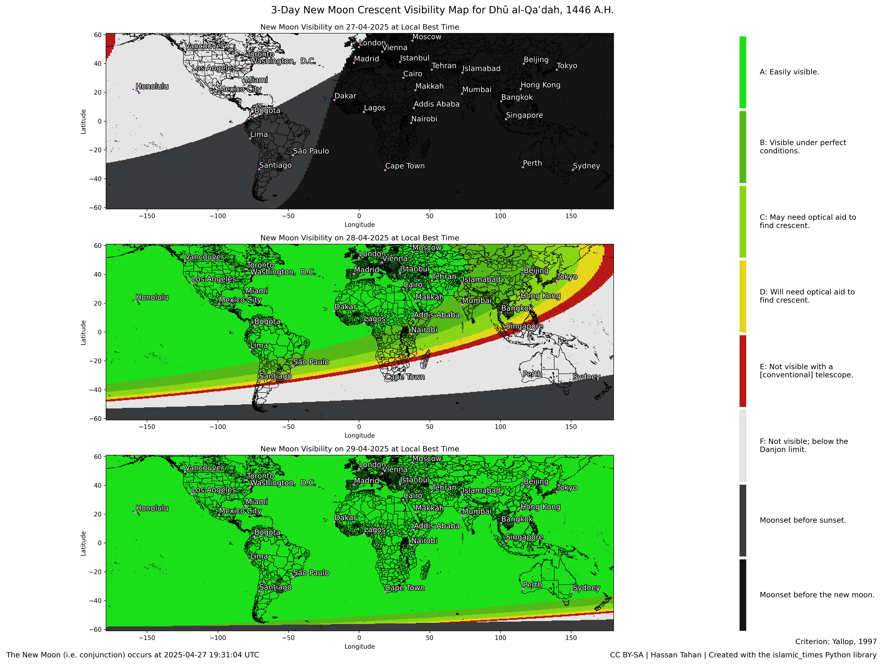

# islamic_times

`islamic_times` is a Python package with a native C extension for Islamic astronomical calculations.
It provides prayer times, Hijri date conversion, Qibla direction, and new moon crescent visibility tools.

## Highlights

- Fast numerical core in C (`islamic_times.astro_core`) with Python orchestration APIs.
- `ITLocation` public API for observer-centric calculations.
- Built-in prayer method presets plus custom angle support.
- Crescent visibility computation with Odeh (2006), Yallop (1997), and Shaukat (n.d.) criteria.
- Solar-only prayer schedules, chronological lunar phases, and detailed crescent forecasts.
- Reusable mosque profiles with per-prayer offsets and CSV or iCalendar schedule export.
- Two-way tabular Hijri civil-date conversion.
- Optional map-generation pipeline (`islamic_times.mapper`) for visibility maps.

## Installation

Install core package:

```bash
pip install islamic_times
```

Install optional mapping extras:

```bash
pip install "islamic_times[map]"
```

## Quick Start

```python
from datetime import datetime

from islamic_times.islamic_times import ITLocation

loc = ITLocation(
    latitude=43.651070,
    longitude=-79.347015,
    elevation=10.0,
    temperature=15.0,
    pressure=101.325,
    date=datetime(2025, 4, 1, 12, 0, 0),
    method="ISNA",
    find_local_tz=True,
)

print(loc.prayer_times())
print(loc.mecca())
# criterion: 0=Odeh, 1=Yallop, 2=Shaukat
print(loc.visibilities(days=3, criterion=1))
```

### Example output

```text
Prayer Times at Observer Timezone
        Method:                 Islamic Society of North America (ISNA)
        Fajr:                   05:37:25 01-04-2025
        Sunrise:                06:58:25 01-04-2025
        Ẓuhr:                   13:22:00 01-04-2025
        ʿAṣr:                   16:56:52 01-04-2025
        Sunset:                 19:44:35 01-04-2025
        Maghrib:                19:45:35 01-04-2025
        ʿIshāʾ:                 21:05:53 01-04-2025
        Midnight:               01:20:36 02-04-2025
Mecca
        Distance:               10,505 km               (6,528 mi)
        Direction:              NE                      (+054.611°              (+054° 36′ 40.23″))
Visibility of New Moon Crescent:
        Criterion:              Yallop
        19:58:24 29-03-2025:    -0.308  F: Not visible; below the Danjon limit.
        20:36:14 30-03-2025:    +1.683  A: Easily visible.
        21:14:37 31-03-2025:    +3.966  A: Easily visible.
```

See the [calculation API guide](docs/calculations.md) for date ranges, event statuses,
civil Hijri dates, lunar phases, and explicit conjunction forecasts.

## Mapper CLI (Optional)

Install the mapper dependencies with `pip install "islamic_times[map]"`.
Rendering uses the shapefiles in the repository. Run the render commands from
the repository root or a directory containing the
[`map_shp_files/` folder](https://github.com/hassantahan/islamic_times/tree/master/map_shp_files).

```bash
python -m islamic_times.mapper generate \
  --date 2025-04-27T00:00:00 \
  --map_region WORLD \
  --map_mode category \
  --resolution 300 \
  --days_to_generate 3 \
  --criterion 1 \
  --total_months 1
```

`islamic-times-map` and `python -m islamic_times.mapper` accept the same commands.
Use `--conjunction 2025-04-27T19:31:04+00:00` to anchor a map to the same UTC
conjunction as a local forecast. Category maps use adaptive sampling by default.
Pass `--category-compute dense` to evaluate every cell.
The `benchmark` command writes a timing report to `benchmark.json` under the
map output directory. `--perf-report` overrides that path.

To view a CSV export directory directly:

```bash
python -m islamic_times.mapper export-csv \
  --date 2025-04-27T00:00:00 \
  --map_region WORLD \
  --map_mode category \
  --resolution 300 \
  --days_to_generate 3 \
  --criterion 1 \
  --total_months 1 \
  --csv_path /path/to/export_dir
```

Below is an example of a generated visibility map for the new moon crescent on **2025-04-27 (Dhū al-Qaʿdah 1446)** using the Yallop criterion:



## Timezone and DST Behavior

- With `find_local_tz=False`, naive datetimes are treated as UTC.
- With `find_local_tz=True`, timezone is resolved from coordinates as an IANA zone and DST-aware localization is applied.
- Naive local times that are ambiguous or nonexistent during DST transitions raise `ValueError` with an explicit message.
- `ITLocation.update_time()` in local-timezone mode refreshes timezone offset for the new date (for example winter vs summer offset).

## Development

Contributor workflow, validation commands, and platform-specific shell guidance are in `CONTRIBUTING.md`.

## Project Layout

```text
islamic_times/
├── src/islamic_times/            # Python package (public API + mapper package)
├── src/native/                   # C extension sources
├── src/native/include/           # C headers
├── tests/                        # Automated tests
├── docs/                         # Public, repository-shipped documentation
├── .agents/                      # Internal agent guidance (intentional exception)
├── examples/                     # Runnable examples and probes
├── mapper.py                     # Legacy mapper compatibility entrypoint
├── CONTRIBUTING.md               # Contributor guide
├── RELEASE_CHECKLIST.md          # Release checklist
└── pyproject.toml                # Build + tooling configuration
```

## License

This project is licensed under the [MIT License](LICENSE).

## References

- Jean Meeus, *Astronomical Algorithms*, 2nd Edition, Willmann-Bell, Inc., 1998.
- Prayer time methods: <https://praytimes.org/docs/calculation>
- Delta T approximation: <https://eclipse.gsfc.nasa.gov/SEhelp/deltatpoly2004.html>
- Sources for new moon crescent visibility prediciton criteria:
     - Yallop (1997): <https://www.staff.science.uu.nl/~gent0113/islam/downloads/naotn_69.pdf>
     - Odeh (2006): <https://doi.org/10.1007/s10686-005-9002-5>
     - Shaukat (n.d.): <https://www.moonsighting.com/faq_ms.html>
